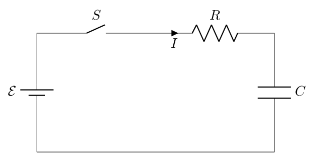
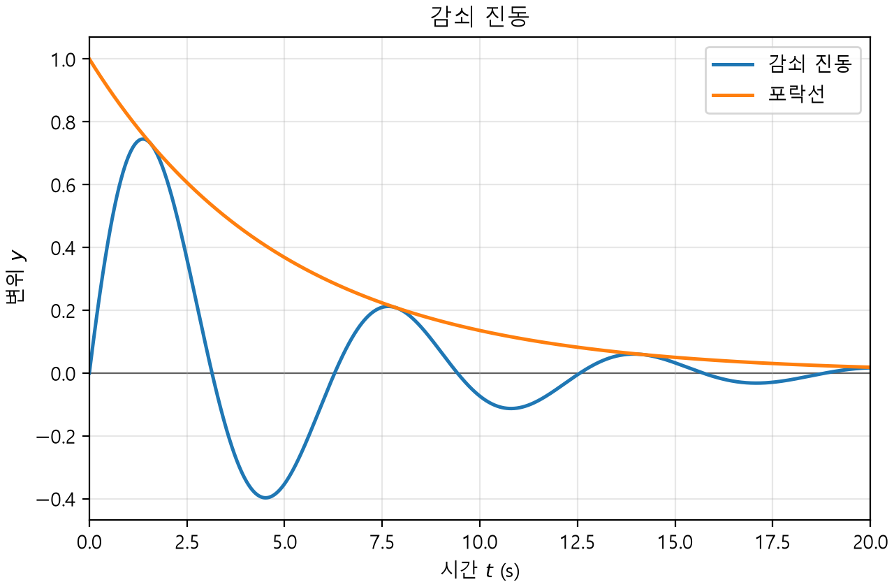
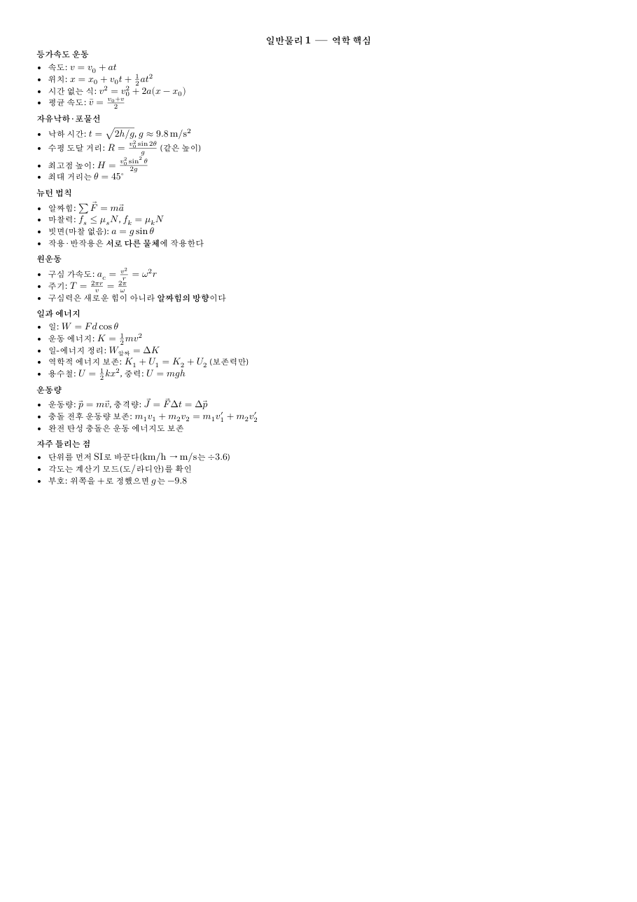

# openstem-mcp

<!-- mcp-name: io.github.kimi94279-glitch/openstem-mcp -->

이공계 공부를 돕는 MCP 서버. 이미 쓰고 있는 AI(Claude 등)에 붙이면 **학술 그림을 그리고, 풀이를 검산하고, 강의 자료(PDF·한글 파일)를 읽어 예상문제·슬라이드·암기 카드·실험 보고서를 만들** 수 있다.
서버는 AI를 따로 부르지 않고 그리기·계산만 하므로 **추가 구독이나 API 키가 필요 없다.** 모든 작업은 내 PC에서 돈다.

> **Your AI. Your Tools. Your Freedom.** 배움은 열려 있어야 한다. 쓰고 싶은 AI 모델과 필요한 도구 사이에서 하나를 고르지 않아도 되게 만든다. → [OpenSTEM 선언문](MANIFESTO.md)

| 회로도 (`render_tikz`) | 함수 그래프 (`plot_function`) | 분자 구조식 (`render_molecule`) |
|:---:|:---:|:---:|
|  |  |  |

| 치트시트 (`export_document`) | 검산 (`verify_math`) |
|:---:|:---|
|  | "$\sin^2 x = \frac{1-\cos 2x}{2}$ 맞아?" → `matches: true`<br>"$(x+1)^2 = x^2+1$?" → `matches: false`, 반례 $x=-2.03$<br>"$\int x e^x dx$" → $(x-1)e^x$ |

## 설치

### 원클릭 (Claude Desktop)

1. **받기** — [릴리스 페이지](https://github.com/kimi94279-glitch/openstem-mcp/releases)에서 `openstem-<버전>.mcpb` 파일을 내려받는다.
2. **더블클릭** — 받은 파일을 더블클릭하면 Claude Desktop에 확장 설치 화면이 열린다. 설치를 누른다(안 열리면 Claude Desktop 설정의 확장 화면에 파일을 끌어다 놓는다).
3. **폴더 고르기** — 결과물 폴더(기본: 문서/OpenSTEM)를 확인하고, 원하면 자료 폴더(AI가 읽을 PDF·한글 파일을 넣는 곳)와 학교 이름·LMS 토큰을 넣은 뒤 켠다(아래 "학교 LMS 연결").

처음 켤 때 파이썬 패키지, LaTeX 엔진(tectonic), TeX 패키지(합쳐 약 500 MB)를 내려받느라 몇 분 걸린다. 그동안 그림·PDF 툴은 "준비 중"이라고 답하니 잠시 뒤 다시 시키면 된다.

### Claude Code 플러그인 (사용 지침 포함)

Claude Code에서 아래 한 줄이면 서버와 함께 사용 지침(스킬 6개: 풀이 검산, 그림, 시험 대비, 실험 보고서, 발표·문서, 학교 LMS)이 설치된다. 켤 때 결과물 폴더·자료 폴더·학교 LMS 설정을 물어본다(모두 선택).

```
/plugin install openstem --marketplace kimi94279-glitch/openstem-mcp
```

### 직접 설치 (Claude Code·설정 파일)

**1. uv 설치** — 파이썬 프로그램을 내려받아 실행해 주는 도구다.

- Windows (PowerShell): `powershell -ExecutionPolicy ByPass -c "irm https://astral.sh/uv/install.ps1 | iex"`
- macOS / Linux: `curl -LsSf https://astral.sh/uv/install.sh | sh`

**2. 미리 준비(선택)** — 그림·PDF를 만드는 LaTeX 엔진(tectonic)은 처음 켤 때 서버가 공식 릴리스를 받아 해시를 확인한 뒤 설치한다. 터미널에서 한 번 실행해 두면 AI 앱에서 처음 쓸 때 기다리지 않는다(처음 한 번만, 약 300 MB, 3~5분):

```bash
uvx openstem-mcp --warmup
```

자동 설치를 원하지 않으면 환경변수 `OPENSTEM_NO_DOWNLOAD=1`을 두고 tectonic을 직접 설치한다: Windows는 [tectonic 릴리스](https://github.com/tectonic-typesetting/tectonic/releases)의 `x86_64-pc-windows-msvc.zip`에서 `tectonic.exe`를 PATH 폴더에, macOS는 `brew install tectonic`, Linux는 `curl --proto '=https' --tlsv1.2 -fsSL https://drop-sh.fullyjustified.net | sh` 후 `mv tectonic ~/.local/bin/`.

**3. AI 앱에 연결**

Claude Desktop: 앱을 **완전히 종료**한 뒤(트레이 아이콘 → 종료) 설정 파일 `claude_desktop_config.json`에 아래를 넣고 다시 켠다.
(Windows `%APPDATA%\Claude\`, macOS `~/Library/Application Support/Claude/`. 앱이 켜진 채로 고치면 앱이 덮어쓴다.)

```json
{
  "mcpServers": {
    "openstem": { "command": "uvx", "args": ["openstem-mcp"] }
  }
}
```

Claude Code:

```bash
claude mcp add openstem -- uvx openstem-mcp
```

설정을 더 하고 싶으면(선택) 같은 자리에 `env`와 `args`를 넣는다. 예: 결과물 폴더 바꾸기, tectonic 위치 지정, LaTeX 입력 검산 켜기.

```json
{
  "mcpServers": {
    "openstem": {
      "command": "uvx",
      "args": ["--from", "openstem-mcp[latex]", "openstem-mcp"],
      "env": {
        "OPENSTEM_OUTPUT_DIR": "D:\\공부\\그림",
        "OPENSTEM_TECTONIC": "C:\\Users\\<이름>\\.local\\bin\\tectonic.exe"
      }
    }
  }
}
```

macOS에서 앱이 `uvx`나 tectonic을 못 찾으면(앱은 터미널과 PATH가 다를 수 있다) 터미널에서 `which uvx`, `which tectonic`으로 나온 전체 경로를 `command`와 `OPENSTEM_TECTONIC`에 넣는다.

## ChatGPT에서 쓰기

ChatGPT는 인터넷의 HTTPS 주소로만 MCP 서버에 붙는다. 그래서 내 PC에서 서버를 HTTP 모드로 켜고, cloudflared로 임시 HTTPS 주소를 연다. ChatGPT 요금제에 따라 사용자 지정 MCP(개발자 모드)를 쓸 수 없거나 읽기 툴만 될 수 있다.

1. cloudflared 설치(한 번만): Windows `winget install --id Cloudflare.cloudflared`, macOS `brew install cloudflared`, Linux는 Cloudflare 문서의 패키지 설치 안내
2. 서버 켜기: `uvx openstem-mcp --http --tunnel` → 터미널에 `ChatGPT 커넥터 URL: https://….trycloudflare.com/<비밀 키>/mcp`가 나온다
3. ChatGPT 설정 → 앱(또는 커넥터) → 고급 설정에서 개발자 모드를 켜고, 사용자 지정 MCP 서버(앱 만들기)에 위 URL을 붙여 넣은 뒤 인증은 "없음"을 고른다(메뉴 이름은 바뀔 수 있다)

- URL 가운데의 긴 문자열이 비밀 키다. 키가 틀린 요청은 모두 404다. 남에게 보여 주지 말고, 새어 나갔으면 `--new-secret`으로 바꾼다.
- 임시 터널 주소는 켤 때마다 바뀌므로 ChatGPT에 새 URL을 다시 넣어야 한다(비밀 키는 그대로).
- 터미널 창을 닫거나 PC가 잠들면 연결이 끊긴다. 그림·문서는 서버를 켠 이 PC의 결과물 폴더에 저장된다.
- 터널 없이 이 PC 안에서만 쓰려면 `uvx openstem-mcp --http` → `http://127.0.0.1:8765/<비밀 키>/mcp`(또는 `/mcp`에 헤더 `Authorization: Bearer <키>`). 포트는 `--port`로 바꾼다.

## 이렇게 쓴다

AI에게 평소처럼 말하면 된다.

- "RC 직렬회로 그려줘", "빗면 위 물체의 자유물체도 그려줘", "PID 제어 블록도 그려줘"
- "y = sin(x)·e^(−x/5) 그래프 그려줘", "아스피린 구조식 보여줘"
- "이 적분 풀고 단계마다 검산해줘", "y'' + 3y' + 2y = sin x 풀어줘", "이 행렬 고윳값 구해줘"
- "이 답 단위 맞아?", "72 km/h를 m/s로"
- "자료 폴더의 3장 PDF로 예상문제 10개랑 해설 만들어줘"
- "이 측정값으로 그래프 그리고 기울기 구해서 실험 보고서 써줘"
- "이 단원 내용으로 A4 한 장 치트시트 PDF", "발표 슬라이드 10장", "암기 카드 20장 만들어줘"

결과물은 `~/OpenSTEM/`(Windows는 `C:\Users\<이름>\OpenSTEM\`)에 쌓인다. 다른 곳에 두려면 환경변수 `OPENSTEM_OUTPUT_DIR`을 설정한다.

**자료 폴더**: 강의 자료·기출문제·공지(PDF, 한글 HWP·HWPX, 워드, 파워포인트, 엑셀)를 `~/OpenSTEM/자료/`에 넣어 두면 AI가 이름으로 골라 읽는다. 이 폴더(와 결과물 폴더) 밖 파일은 열지 않는다. 다른 곳을 쓰려면 환경변수 `OPENSTEM_INPUT_DIR`을 설정한다. 사진이나 몇 개 안 되는 파일은 채팅에 바로 첨부해도 된다.

AI 앱의 프롬프트 메뉴에서 바로 고를 수도 있다.

| 프롬프트 | 하는 일 |
|---|---|
| `figure` | 비슷한 예제를 찾아 고쳐 그리고, 미리보기를 보고 최대 3번 고친다 |
| `solve` | 단계별로 풀고 핵심 단계마다 검산(단위 포함)한 뒤 최종 답을 낸다 |
| `exam` | 강의 자료·기출로 새 예상문제를 만들고, 답을 검산해 문제지·해설지 PDF로 낸다 |
| `cheatsheet` | 자료를 A4 한 장으로 요약해 PDF로 내보낸다 |
| `slides` | 자료로 발표 슬라이드(pptx)를 만든다. 그림·수식·발표자 노트 포함 |
| `flashcards` | 정의·공식 암기 카드를 오려 쓰는 PDF와 암기 앱용 파일로 만든다 |
| `lab_report` | 측정 데이터로 그래프·맞춤·단위 검사를 하고 실험 보고서(docx)를 쓴다 |

## 학교 LMS 연결 (선택, 읽기 전용)

과목·다가오는 마감·공지·강의 자료를 AI가 읽어 온다. 자료 파일은 자료 폴더의 `LMS/과목명/`으로 받아 바로 읽는다. "일반물리 자료 다 받아 줘"라고 하면 과목 자료를 한 번에 받고, 다음부터는 새로 올라오거나 바뀐 파일만 받는다. 제출·글쓰기는 하지 않고, 비밀번호는 받지 않는다.

**1. 학교 이름 넣기** — 확장 설정의 **학교 이름**에 학교 이름만 넣으면 LMS 주소는 자동으로 찾는다. 줄임말도 된다(성대, 서울대, KAIST, 코리아텍). Claude Code나 설정 파일로 쓸 때는 환경변수 `OPENSTEM_LMS_SCHOOL`을 쓴다.

```bash
claude mcp add openstem -e OPENSTEM_LMS_SCHOOL=성균관대 -e OPENSTEM_LMS_TOKEN=<토큰> -- uvx openstem-mcp
```

AI에게 "LMS 지원 학교 목록 보여 줘"라고 하면 목록과 학교별 연결 방법을 알려 준다.

**2. 토큰 만들기 (LMS 웹사이트에서 직접)**

| LMS | 메뉴 |
|---|---|
| Canvas·LearningX | 계정 → 설정 → 승인된 통합 → **+ 새 액세스 토큰** |
| Moodle·Coursemos | 환경설정 → **보안 키** → 모바일 웹 서비스 키 복사 (메뉴가 안 보이면 `<LMS 주소>/user/managetoken.php`) |

만든 토큰을 확장 설정의 **LMS 액세스 토큰**(또는 `OPENSTEM_LMS_TOKEN`)에 넣고 앱을 다시 켠다. 토큰은 학교 LMS 주소로만 보낸다.

**3. 토큰을 만들 수 없을 때: 캘린더 주소 (마감만)** — 학교가 학생 토큰을 막았거나 모바일 서비스가 꺼져 있으면(연세대 LearnUs, 동국대, 한국기술교육대) LMS 캘린더의 구독 주소로 **과제 마감만** 읽을 수 있다.

| LMS | 메뉴 |
|---|---|
| Canvas·LearningX | 캘린더 → 오른쪽 **캘린더 피드** → 주소 복사 (`…/feeds/calendars/user_….ics`) |
| Moodle·Coursemos | 달력 → **일정 내보내기** → 모든 일정, 최근과 다가오는 일정 → 캘린더 URL 가져오기 → 주소 복사 (`…/calendar/export_execute.php?…`) |

주소를 확장 설정의 **LMS 캘린더 주소**(또는 `OPENSTEM_LMS_CALENDAR_URL`)에 넣는다. 이 주소만 있으면 누구나 내 일정을 볼 수 있으니 비밀번호처럼 다룬다(도구도 결과에 싣지 않는다). 토큰과 캘린더 주소를 둘 다 넣으면 토큰을 먼저 쓰고 캘린더에만 있는 일정을 덧붙인다.

**지원 학교 (2026년 11월, 공개 페이지 조사)**

| 구분 | 학교 |
|---|---|
| LearningX(Canvas) 11곳 | 서울대, 고려대, 성균관대, 한양대, 중앙대, 경희대, 숭실대, 경북대, 경상국립대, 제주대, 단국대 |
| Coursemos·Moodle 22곳 | 연세대\*, 서울시립대, 이화여대, 동국대\*, 홍익대, 국민대, 세종대, 인하대, 숙명여대, 상명대, KAIST, POSTECH, GIST, 한국기술교육대\*, 부산대, 전남대, 전북대, 충북대, 강원대, 인천대, 한국항공대, 울산대 의과대학 |
| 지원 안 됨 | ILOS: 서강대, 한국외대, 건국대, 명지대, 가톨릭대, 서울과기대, 한국공학대, 부경대, 영남대 · Blackboard: 아주대, UNIST, DGIST · 자체·기타: 광운대(KLAS), 충남대(권역 플랫폼), 울산대(uclass), 계명대 |

\* 모바일 서비스가 꺼져 있어 토큰 대신 캘린더 주소를 쓴다.

- LearningX 학교는 학생이 아는 주소(예: icampus.skku.edu)와 실제 API 주소(canvas.skku.edu)가 다르다. 학교 이름만 넣으면 알아서 맞는 주소를 쓴다.
- 고려대·중앙대·경희대 등 일부는 학생이 토큰을 만들 수 있는지 확인하지 못했다. 안 되면 캘린더 주소를 쓴다. 실제 학교 LMS로는 아직 시험하지 못했다(가짜 서버로 시험).
- 지원 안 되는 학교: Blackboard는 캘린더에 iCal 링크가 있으면 마감만 읽을 수 있다(확인 못 함). 그 밖에는 강의 자료를 직접 내려받아 자료 폴더에 넣고 AI에게 읽어 달라고 하면 된다.
- 목록에 없는 학교도 Canvas나 Moodle이면 **LMS 주소 직접 지정**(`OPENSTEM_LMS_URL`)과 토큰으로 쓸 수 있다.

## 툴

| 툴 | 하는 일 |
|---|---|
| `render_tikz` | TikZ·circuitikz·pgfplots·chemfig 코드 → SVG·PDF·PNG. 한글 라벨 자동 지원. 에러는 몇 번째 줄인지 알려준다 |
| `get_template` | 검증된 그림 예제 40개(회로·물리·수학·다이어그램 각 10). MCP 리소스 `template://{category}/{name}`로도 열린다 |
| `plot_function` | 수식 그래프. 점근선·불연속(점프)·정의역 밖 구간을 찾아 알려주고 데이터 점을 겹쳐 찍는다 |
| `plot_data` | 측정 데이터 그래프. 표·CSV를 붙여 넣으면 오차 막대, 직선·다항·지수·거듭제곱·로그 맞춤(± 표준오차, R²), 튀는 점 표시 |
| `render_molecule` | SMILES → 분자 구조식·반응식, 분자식·분자량 |
| `verify_math` | 같은 식인지 판정(반례·수치 비교), 간단히 하기, 방정식, 미분, 적분, 극한, 값 계산, 미분방정식, 행렬, 라플라스 변환, 급수, 부등식, 확률분포 |
| `check_units` | 답의 단위·차원 검사(어느 차원이 어긋났는지 설명), 단위 변환 |
| `read_document` | 자료 폴더의 PDF·한글(HWP·HWPX)·워드·파워포인트·엑셀·텍스트·그림 읽기. 스캔본 PDF는 쪽 그림으로 |
| `export_document` | 마크다운(수식·그림·표) → pdf·docx·pptx. 배치: 보통 문서, A4 치트시트, 시험지(해설 분리), 플래시카드 |
| `lms` | 학교 LMS(LearningX·Canvas, Coursemos·Moodle) 읽기: 과목, 마감(토큰 없이 캘린더 주소로도), 공지, 자료 목록, 자료 파일 받기, 과목 자료 한 번에 받기(새로 올라오거나 바뀐 것만, 자료 폴더로), 지원 학교 목록 |

## 자주 묻는 것

- **처음 그림이 안 나오고 "준비 중"이라고 한다** — 첫 실행 때 TeX 패키지를 받는 중이다(3~5분, 한 번만). 설치 2단계의 `--warmup`을 미리 해 두면 생기지 않는다.
- **"tectonic을 찾을 수 없다" / "자동 설치 실패"** — 서버가 tectonic을 받지 못한 경우다(인터넷·방화벽, 또는 Windows ARM처럼 공식 파일이 없는 PC). 직접 설치 2단계의 안내대로 tectonic을 설치하고 AI 앱을 다시 켠다. PATH 밖에 두었다면 위 설정 예시처럼 `OPENSTEM_TECTONIC`에 실행 파일 경로를 넣는다.
- **"TeX 패키지를 내려받지 못했다"** — 처음 쓰는 패키지는 tectonic 서버에서 받아 온다. 인터넷 연결이나 학교·회사 방화벽을 확인한다.
- **LaTeX로 쓴 식을 검산하고 싶다** — `verify_math`의 `latex=true`는 선택 기능이다. 위 설정 예시처럼 `openstem-mcp[latex]`로 실행하면 켜진다. 없어도 AI가 sympy 문법으로 바꿔 보낸다.
- **물리 공식 검산이 "틀림"으로 나온다** — 변수를 음수일 수도 있는 실수로 보면 `√(m²v²) = mv` 같은 변형이 틀린 게 맞다. 물리량은 AI가 `assume="positive"`로 검산하게 되어 있다.
- **설치가 안 되는 컴퓨터** — Windows ARM(Snapdragon 등)은 pandoc 패키지가 없어 지원하지 않는다.
- **안전한가** — 임의 코드를 실행하는 툴은 없다. LaTeX·수식·SMILES는 별도 프로세스에서 시간 제한을 두고 처리하고, 파일을 읽거나 쓰는 TeX 명령(이름을 조립해 우회하는 방법 포함)과 결과물 폴더 밖·인터넷 그림은 컴파일 전에 막는다.

## 개인정보

만든 사람은 서버를 운영하지 않고 어떤 데이터도 모으지 않는다(분석·추적 없음). 네트워크 연결은 설치(PyPI), tectonic 자동 설치(공식 GitHub 릴리스, 해시 확인), TeX 패키지(tectonic 서버), 설정한 경우 학교 LMS뿐이다. 자세한 내용: [PRIVACY.md](PRIVACY.md)

## 개발

필요한 것: [uv](https://docs.astral.sh/uv/), [tectonic](https://tectonic-typesetting.github.io/)

```bash
uv sync --all-extras
uv run openstem-mcp --warmup
uv run pytest
npx @modelcontextprotocol/inspector uv run openstem-mcp
```

Claude Desktop에 개발 버전을 붙이려면(Windows): Claude Desktop을 완전히 종료 → `python scripts/register_claude_desktop.py` → 다시 켜기.

설계 원칙과 구현 메모는 [CLAUDE.md](CLAUDE.md)에 있다.

## 라이선스

MIT
